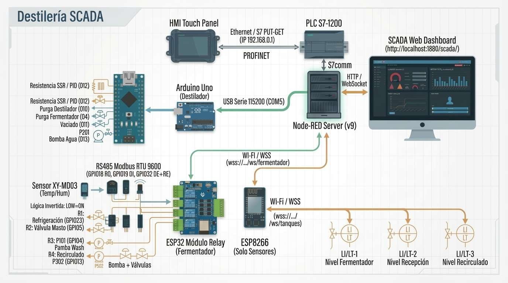
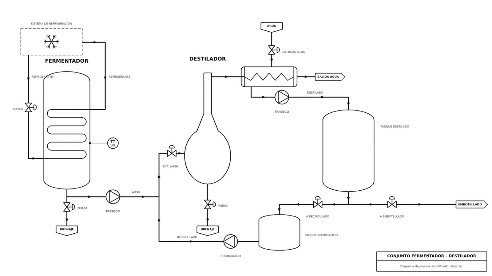
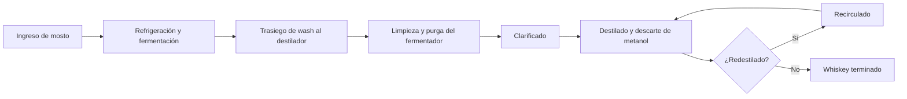
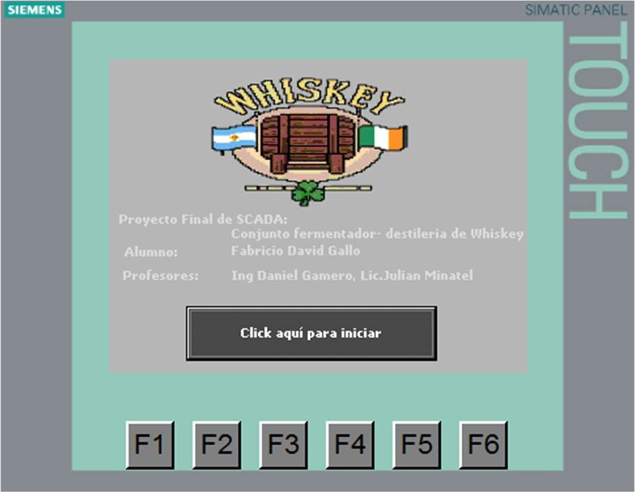
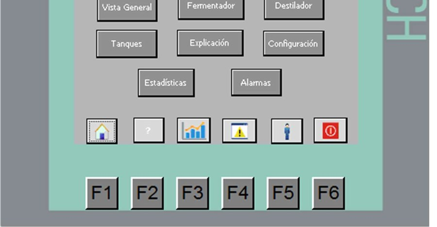
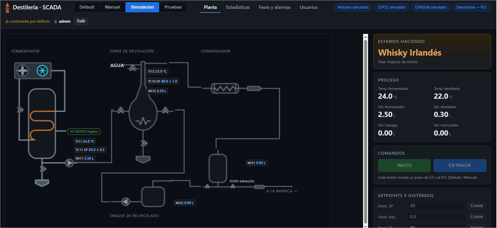
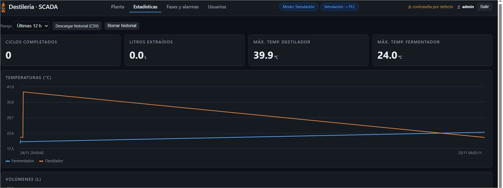
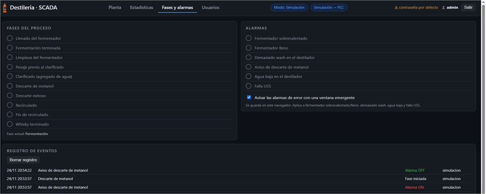
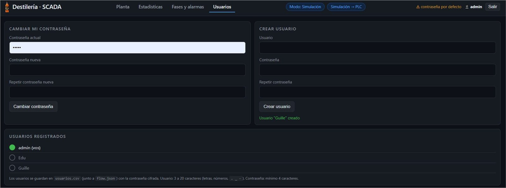

# Destilería SCADA


## Sistema semiautomatizado para destilería de whiskey artesanal

**Trabajo Práctico Final de SCADA** (Sistemas de Supervisión, Control y Adquisición de Datos)
Licenciatura en Automatización y Control de Procesos Industriales, 1.º año, ciclo lectivo 2026
Universidad Autónoma de Entre Ríos (UADER), Facultad de Ciencia y Tecnología (FCyT)

**Autor:** Fabricio David Gallo
**Docentes:** Ing. Daniel Gamero y Lic. Julián Minatel

---

## Resumen

Este repositorio contiene el desarrollo completo de un sistema SCADA aplicado a una pequeña empresa ficticia de elaboración artesanal de whiskey. El sistema automatiza y supervisa las etapas de **fermentación** y **destilación** (con redestilado); las restantes etapas del proceso (malteado, molienda, maceración y maduración en barricas) se consideran manuales.

La solución integra tres niveles funcionales:

| Nivel | Componentes |
|---|---|
| Campo | ESP32 (fermentador), ESP8266 (tanques) y Arduino UNO (destilador y purgas), con sus sensores y actuadores |
| Control | PLC Siemens S7-1200 (CPU 1212C DC/DC/DC) programado en lenguaje Ladder, y panel HMI Siemens KTP600 Basic Color PN |
| Supervisión | Servidor Node-RED con interfaz web (uibuilder), expuesto a internet mediante Pangolin |

## Objetivos académicos

El trabajo integra los contenidos desarrollados en la cátedra:

- Programación en lenguaje Ladder.
- Comprensión del ciclo de SCAN del controlador.
- Uso de un PLC de la marca Siemens.
- Registro de datos (*data logging*) y exportación de históricos.
- Desarrollo de interfaces hombre-máquina (HMI), incluyendo alarmas, control de usuarios, datos históricos, múltiples pantallas, plantillas y recetas.

---

## Arquitectura del sistema



*Figura 1. Arquitectura general: panel HMI y PLC S7-1200 sobre PROFINET, servidor Node-RED conectado al PLC por S7comm, y microcontroladores de campo (Arduino por puerto serie; ESP32 y ESP8266 por WebSocket seguro).*

Los microcontroladores no toman decisiones de proceso: adquieren señales, ejecutan las órdenes recibidas y reportan su estado. La lógica de control reside en el PLC, y Node-RED actúa como pasarela entre el PLC, los microcontroladores y la interfaz web.

---

## Descripción del proceso



*Figura 2. Diagrama de proceso simplificado del conjunto fermentador-destilador.*



1. **Ingreso de mosto.** El operario autoriza el ingreso desde el pulsador físico, el HMI o el SCADA web.
2. **Fermentación.** El mosto se enfría hasta la temperatura de inoculación y se emite una alarma para que el operario incorpore la levadura manualmente. Luego el setpoint pasa a la temperatura crítica de fermentación. La finalización se determina por la pérdida de peso de la mezcla debida al desprendimiento de CO₂ (*pérdida crítica*).
3. **Trasiego.** El wash se bombea al destilador y el fermentador se purga una vez vacío.
4. **Clarificado.** Se pesa el wash y se incorpora un porcentaje de agua definido por la receta.
5. **Destilado.** Un control PID regula la temperatura medida a la salida del condensador (*spirit safe*). El proceso se detiene para el descarte de las cabezas (metanol) y se reanuda al confirmarse dicho descarte.
6. **Corte.** Una celda de carga registra la variación de peso; al superarse el porcentaje de corte por tasa de evaporación (*drop rate threshold*) se desactiva la resistencia y se notifica al operario.
7. **Redestilado.** Se realiza por recirculado, con la cantidad de ciclos que establece la receta.
8. **Finalización.** El operario traslada el producto a la barrica.

### Descarte de metanol

Durante la fermentación y la destilación se generan compuestos volátiles además del etanol. El metanol es altamente tóxico: su ingesta puede provocar acidosis metabólica severa, daño irreversible del nervio óptico, coma y muerte (OPS, 2025). Por ello el sistema detiene el destilado y requiere la confirmación del descarte de cabezas antes de continuar. El porcentaje de descarte suele ubicarse entre el 2 % y el 5 %; el valor por defecto adoptado es **4 %** y es editable por el operario. El marco normativo de referencia es el Código Alimentario Argentino (Capítulo XIV) y la Ley N.º 18.284.

---

## Parámetros configurables

| Parámetro | Rango típico |
|---|---|
| Setpoint de maceración | 60 a 85 °C |
| Banda de histéresis | 0,5 a 10 °C |
| Kwa (relación agua/grist) | 2,5 a 4 L/kg |
| Tiempo de maceración | 40 a 75 min |
| Kret (retención de líquido del grano) | 1,20 a 1,75 |
| Temperatura de inoculación | 16 a 24 °C |
| Temperatura crítica de fermentación | 33 a 36 °C |
| Pérdida crítica por CO₂ | 3 a 8 % (típica 4 %) |
| Temperatura a la salida del condensador | 12 a 25 °C |
| Porcentaje de corte por tasa de evaporación | aprox. 45 % (35 a 65 % según receta) |
| Descarte de cabezas | 2 a 5 % (por defecto 4 %) |

### Recetas

Se utiliza una única receta genérica denominada *whiskey*, con varios registros (por ejemplo, Irlandés, Blend y Bourbon). Cada registro almacena el setpoint y la histéresis del fermentador y del destilador, el porcentaje de agua, los ciclos de redestilado, el porcentaje de redestilado y los porcentajes de purga.

> Los valores de las recetas son ilustrativos y se emplean únicamente para verificar el funcionamiento del sistema; no corresponden a datos reales de fabricación de dichas variedades.

---

## Alarmas y fases

La supervisión combina **avisos analógicos** (niveles y volúmenes comparados contra límites fijos o contra parámetros de la receta activa) y **avisos digitales** (bits de las palabras de estado `AlarmasWord0`, `%DB6.DBW0`, y `AlarmasWord2`, `%DB6.DBW4`, con adquisición cada 500 ms). Se clasifican en tres categorías: *Errors*, *Warnings* y *Ack*.

| Categoría | Aviso | Mensaje |
|---|---|---|
| Errors | `FermentadorSobreCalentado` | Fermentador sobrecalentado: revisar refrigeración |
| Errors | `AlarmaDeDescarteDeMetanol` | Hay que descartar el metanol |
| Errors | `FermentadorLleno` | Fermentador lleno: no puede ingresar más mosto |
| Errors | `AlambiqueConPocoLiquido` | Destilador sin líquido: calentamiento apagado |
| Warnings | `DemasiadoWashEnDestilador` | Demasiado wash en el destilador: purgar |
| Warnings | `FermentadorConPocoLiquido` | Nivel inferior al recomendable: refrigeración apagada |
| Warnings | `WhiskeyTerminado` | Whiskey terminado: extraer producto |
| Ack | `FermentacionTerminada`, `InicioDeDestilado`, `DescarteExitoso`, `FinDeRecirculado`, entre otros | Avisos de cambio de fase |

---

## Estructura del repositorio

```text
.
├── micros/
│   ├── arduino-destilador/          Arduino UNO: destilador (PID) y purgas
│   ├── esp32-fermentador/           ESP32: refrigeración, válvulas y RS485
│   └── esp8266-tanques/             ESP8266: niveles (HX711 y potenciómetro)
├── plc-hmi/
│   └── whiskeria/                   Proyecto TIA Portal (S7-1200 y KTP600)
├── scada-node-red/
│   ├── node-red/
│   │   ├── flow.json                Flujo de Node-RED
│   │   ├── tabla_de_direcciones.md  Correspondencia PLC y Node-RED
│   │   ├── Arrancar.bat
│   │   └── Arrancar_con_newt.bat    Inicia además el túnel de Pangolin
│   └── uibuilder/scada/src/         Interfaz web (HTML, JS, CSS e imágenes P&ID)
└── docs/
    ├── informe_scada_gallo.pdf      Informe del trabajo práctico
    └── img/                         Figuras utilizadas en este documento
```

### Bloques del programa del PLC

| Bloque | Función |
|---|---|
| `OB100` Startup | Inicialización |
| `OB126` control | Lógica principal |
| `OB124` Configuración y ciclo de programa | Ciclo del destilador |
| `OB127` Cálculo de límites on/off | Límites del destilador |
| `OB31` Control de temperatura | PID del destilador |
| `OB125` Recirculado | Redestilado |
| `DB1` Proceso, `DB2` ControlManual, `DB4` DatosDeRecetas, `DB6` Alarmas | Bloques de datos |

---

## Interfaz hombre-máquina (HMI)

- Panel KTP600 Basic Color PN, resolución 320×240, programado en TIA Portal.
- Pantallas de **navegación** (Home, Alarmas, Estadísticas, Recetas, P&ID, Administración de usuarios y gráficos) y de **proceso** (Vista general, Fermentador, Alambique, Tanques y Configuración), basadas en una plantilla común con botonera de acceso rápido, fecha y hora, y logotipo institucional.
- Tres niveles de acceso: **Administración** (acceso total), **Operario** (acceso a configuración) y **Monitorización** (solo visualización).



*Figura 3. Pantalla de inicio del HMI.*



*Figura 4. Menú principal del HMI tras el inicio de sesión.*

## SCADA web (Node-RED y uibuilder)

La interfaz web reproduce el HMI mediante una vista tipo P&ID cuyos elementos (válvulas, bombas y resistencia) cambian de estado visual según las marcas del PLC. Consta de cuatro páginas: *Planta*, *Estadísticas* (gráficos y descarga del historial en CSV), *Fases y alarmas* (con registro de eventos) y *Usuarios*.

| Modo de operación | Descripción |
|---|---|
| Default | Interconecta los datos de los microcontroladores con el PLC y viceversa |
| Manual | Permite forzar actuadores; equivale al modo manual del HMI |
| Pruebas | Permite forzar variables de temperatura para observar la respuesta del PLC |
| Simulación | Simula un ciclo completo de destilado sin los microcontroladores conectados |

A diferencia del HMI, el control de usuarios del SCADA web admite un único perfil, el de administrador.



*Figura 5. Vista de planta del SCADA web (modo Simulación).*



*Figura 6. Estadísticas: indicadores, gráfico de temperaturas y descarga del historial en CSV.*



*Figura 7. Fases del proceso, alarmas y registro de eventos.*



*Figura 8. Gestión de usuarios.*

---

## Puesta en marcha

### Requisitos

- Node.js y Node-RED, con `node-red-contrib-uibuilder` y los nodos para S7 y puerto serie.
- TIA Portal y un S7-1200 con acceso PUT/GET habilitado y bloques de datos sin acceso optimizado.
- Arduino IDE con las bibliotecas `WebSockets` (Links2004), `ArduinoJson` v7, `ModbusMaster`, `HX711` y `DHT`.
- Opcionalmente, el cliente Newt de Pangolin para exponer el SCADA a internet.

### Procedimiento

1. Abrir `plc-hmi/whiskeria` en TIA Portal y descargar el programa al PLC y al panel.
2. En cada microcontrolador, copiar `redes.example.h` como `redes.h`, completar las redes WiFi y cargar el programa correspondiente.
3. Ajustar en Node-RED el puerto COM del Arduino y la dirección IP del PLC, y ejecutar `scada-node-red/node-red/Arrancar.bat` (o `Arrancar_con_newt.bat` para iniciar también el túnel).
4. Acceder a `http://localhost:1880/scada/`.

La correspondencia de direcciones entre el PLC y Node-RED se documenta en `scada-node-red/node-red/tabla_de_direcciones.md`.

---

## Consideraciones de seguridad

- El SCADA se inicia con un usuario `admin` de contraseña por defecto, situación que la propia interfaz advierte. Se recomienda modificarla desde la pestaña *Usuarios*.
- Las credenciales de usuarios se almacenan cifradas en `usuarios.csv`.
- No deben versionarse los archivos `redes.h` (credenciales WiFi), `usuarios.csv` ni `newt_config.bat` (identificador y secreto de Newt). Se proveen en su lugar archivos de ejemplo.

---

## Tecnologías empleadas

Lenguaje Ladder, TIA Portal, Siemens S7-1200 y KTP600, Node-RED, uibuilder, JavaScript, HTML y CSS, C++ para Arduino, ESP32, ESP8266, Modbus RTU sobre RS485, WebSocket seguro (WSS), HX711, Pangolin (WireGuard) y Mermaid.

## Referencias

- Pangolin. *Introduction to Pangolin*. https://docs.pangolin.net/
- Node-RED. *Documentation*. https://nodered.org/docs/
- Knight, J. *UIBUILDER Documentation* (node-red-contrib-uibuilder). https://totallyinformation.github.io/node-red-contrib-uibuilder/
- Ley N.º 18.284 (1969). *Código Alimentario Argentino*. https://www.argentina.gob.ar/normativa/nacional/ley-18284-20776
- Ministerio de Salud de la Nación. *Código Alimentario Argentino, Capítulo XIV: Bebidas*. https://www.argentina.gob.ar/anmat/codigoalimentario
- Organización Panamericana de la Salud (2025). *Alerta epidemiológica: riesgo de intoxicación por metanol*. https://www.paho.org/es

## Autoría

Fabricio David Gallo. GitHub: https://github.com/FDavidGallo. LinkedIn: https://linkedin.com/in/fabricio-david-gallo-28468a1bb.
